# 基于springboot的网上购物商城系统研发

> 🎓 **计算机毕业设计 · 基于springboot的网上购物商城系统研发**
>
> 本仓库只放**项目介绍 + 运行截图**（截图是站点带水印的原图，存在仓库 `images/` 里）。
>
> 👉 **完整可运行源码 / 数据库脚本 / 部署文档：[点我获取](https://geekcode.top/archives/%E5%9F%BA%E4%BA%8Espringboot%E7%9A%84%E7%BD%91%E4%B8%8A%E8%B4%AD%E7%89%A9%E5%95%86%E5%9F%8E%E7%B3%BB%E7%BB%9F%E7%A0%94%E5%8F%91?utm_source=github)**
>
> 💬 咨询微信：**ir9372**　|　🌐 更多项目：[极客代码 geekcode.top](https://geekcode.top/?utm_source=github)
>
> 📌 项目详情页：<https://geekcode.top/archives/%E5%9F%BA%E4%BA%8Espringboot%E7%9A%84%E7%BD%91%E4%B8%8A%E8%B4%AD%E7%89%A9%E5%95%86%E5%9F%8E%E7%B3%BB%E7%BB%9F%E7%A0%94%E5%8F%91?utm_source=github>

<table><td width="230" align="center"> <b>扫码加微信 ir9372</b></td><td valign="middle">📦 源码 = 项目介绍 + 全部运行截图 + 数据库 + 部署文档 👉 点上方任意截图，直接跳到 <b>极客代码 geekcode.top</b> 详情页</td></table>

---

<h1>基于springboot的网上购物商城系统研发</h1>
<h2>项目概述</h2>

本项目旨在研发一套基于 Spring Boot 的网上购物商城系统，以解决传统电商系统在数据一致性、并发处理及后台管理效率方面的痛点。系统采用前后端分离架构，核心功能涵盖商品展示、在线交易、订单管理及商家运营等全流程业务。适用人群包括普通消费者、入驻商家及平台管理员。技术架构上，后端选用 Spring Boot 结合 MyBatis-Plus 实现高效的数据持久层操作，引入 Apache Shiro 保障系统安全；前端基于 Vue 框架构建用户界面，提供流畅的交互体验。该系统通过模块化设计，实现了从用户注册登录、商品浏览收藏、购物车结算到订单跟踪、评论互动的完整闭环，同时为管理员提供了全面的后台监控与管理能力，具备较高的实用价值与扩展性。

<h2>技术架构</h2>

本系统采用经典的前后端分离架构，确保了系统的可维护性与高内聚低耦合特性。

<strong>1. 后端架构</strong>
后端基于 Java 语言开发，核心框架为 Spring Boot，利用其自动配置特性简化部署流程。持久层采用 MyBatis-Plus，在 MyBatis 基础上增强 CRUD 操作，减少样板代码。安全控制模块集成 Apache Shiro，负责身份认证、授权管理及会话控制，确保接口访问的安全性。数据库连接使用 MySQL，驱动为 mysql-connector-java。此外，引入了 commons-lang3 和 validation-api 用于工具类封装及参数校验，protobuf-java 支持高效的数据序列化传输。

<strong>2. 前端架构</strong>
前端采用 Vue.js 框架构建单页面应用（SPA），通过路由机制实现前台用户端与后台管理端的视图切换。界面设计注重响应式布局，适配不同终端设备。前后端通过 RESTful API 进行数据交互，统一返回 JSON 格式数据。

<strong>3. 数据库设计要点</strong>
数据库设计遵循第三范式，主要包含用户表、商品表、分类表、订单表、地址表、收藏表、评论表及商家信息等核心实体。通过外键关联或逻辑关联建立数据完整性约束，例如订单与用户、商品的关联，以及评论与用户的关联。针对高频查询字段如商品名称、订单状态等建立索引以提升检索性能。

<strong>4. 核心技术选型理由</strong>
选择 Spring Boot 是因为其生态丰富且能快速构建微服务原型；MyBatis-Plus 相比原生 JDBC 大幅提升了开发效率；Shiro 相比 Spring Security 更轻量且易于定制，适合中小型电商系统的安全需求；Vue 框架组件化程度高，便于复用与维护。

<h2>功能模块</h2>

根据代码上下文及截图信息，系统功能划分为前台用户端和后台管理端两大部分。

<h3>前台用户端功能</h3>

前台界面主要面向普通消费者，提供完整的购物体验及相关个人中心服务。

<ul>
<li><strong>首页与信息展示</strong>：展示轮播图及推荐商品信息，支持按商品分类浏览商品列表。</li>
<li><strong>用户认证</strong>：提供用户注册与登录入口，确保账户安全。</li>
<li><strong>商品详情与互动</strong>：查看商品详细信息，支持发表商品评论及查看其他用户评论列表。</li>
<li><strong>购物车管理</strong>：添加商品至购物车，查看购物车列表，进行数量调整及结算准备。</li>
<li><strong>个人中心</strong>：</li>
<li><strong>我的订单</strong>：查看历史订单及当前订单状态，支持按状态筛选订单。</li>
<li><strong>我的地址</strong>：管理收货地址，包括新增、编辑、删除及设为默认地址。</li>
<li><strong>我的收藏</strong>：查看已收藏的商品列表，支持取消收藏。</li>
<li><strong>个人信息</strong>：查看及修改个人基本资料。</li>
<li><strong>客服沟通</strong>：提供即时聊天窗口，支持与商家或平台客服进行消息交互。</li>
</ul>
<h3>后台管理端功能</h3>

后台界面面向平台管理员，提供全局资源管理与业务监控能力。

<ul>
<li><strong>仪表盘首页</strong>：展示系统关键数据概览及快捷入口。</li>
<li><strong>用户管理</strong>：对注册用户信息进行查询、审核及管理。</li>
<li><strong>商家管理</strong>：维护入驻商家的基本信息及资质审核。</li>
<li><strong>商品管理</strong>：</li>
<li><strong>商品信息</strong>：发布新商品，编辑现有商品详情，下架或删除商品。</li>
<li><strong>商品分类</strong>：管理商品所属的分类层级，支持增删改查。</li>
<li><strong>订单管理</strong>：查看所有订单状态，处理异常订单，跟踪物流及支付情况。</li>
<li><strong>内容管理</strong>：</li>
<li><strong>轮播图管理</strong>：配置首页轮播图的图片链接及排序。</li>
<li><strong>评论管理</strong>：审核用户发布的商品评论，删除违规内容。</li>
<li><strong>系统配置</strong>：管理系统基础参数及全局设置。</li>
<li><strong>客服管理</strong>：查看并回复来自前端的用户咨询消息。</li>
<li><strong>收藏管理</strong>：查看用户的收藏记录数据。</li>
</ul>
<h2>用户角色与权限</h2>

系统主要涉及三种角色，各角色拥有不同的操作权限边界，由 Apache Shiro 进行细粒度控制。

<table>
<thead>
<tr>
<th align="left">角色</th>
<th align="left">主要职责</th>
<th align="left">权限范围描述</th>
</tr>
</thead>
<tbody><tr>
<td align="left"><strong>普通用户</strong></td>
<td align="left">消费与互动</td>
<td align="left">仅限访问前台页面。可进行注册登录、浏览商品、加入购物车、下单购买、管理个人地址、收藏商品、发表评论以及与客服聊天。无法访问后台管理界面，无权查看其他用户隐私数据。</td>
</tr>
<tr>
<td align="left"><strong>商家</strong></td>
<td align="left">商品运营</td>
<td align="left">根据路由 <code>/shangjia</code> 及后台功能推断，商家可能拥有独立的后台入口或受限的管理权限，主要用于维护自身店铺的商品信息、处理相关订单及回复客户咨询。（注：具体商家独立后台权限细节需结合源码进一步确认，此处基于通用电商逻辑描述）。</td>
</tr>
<tr>
<td align="left"><strong>管理员</strong></td>
<td align="left">系统运维</td>
<td align="left">拥有最高权限，可访问所有后台路由（如 <code>/yonghu</code>, <code>/orders/:status</code>, <code>/config</code> 等）。负责全平台数据的增删改查，包括用户封禁、商品上架审核、订单全局监控、轮播图配置、评论审核及系统参数设置。</td>
</tr>
</tbody></table>
<h2>项目特色与创新点</h2>
<ol>
<li><strong>安全高效的权限控制体系</strong>：引入 Apache Shiro 框架，实现了基于注解的权限拦截与会话管理，有效防止未授权访问，保障了用户数据及交易信息的安全性。</li>
<li><strong>完善的即时通讯功能</strong>：集成 ChatController 及相关前端界面，实现了用户与商家/客服之间的实时消息交互，提升了平台的用户体验与服务响应速度，区别于传统静态电商系统。</li>
<li><strong>灵活的数据持久层设计</strong>：采用 MyBatis-Plus 替代传统 MyBatis，通过 Lambda 表达式构建动态 SQL，显著减少了 XML 映射文件的编写工作量，提高了复杂查询条件下的代码可读性与维护性。</li>
<li><strong>前后端完全解耦</strong>：前端基于 Vue 构建，后端仅提供 RESTful 接口，使得系统具备良好的跨平台扩展潜力，未来可轻松移植至移动端 App 或小程序，无需重构后端逻辑。</li>
<li><strong>闭环的业务流程</strong>：涵盖了从“浏览-收藏-加购-下单-支付-评论”的完整 C2C/B2C 电商链路，并配套了后台的“审核-发货-售后”管理链路，形成了自洽的业务生态。</li>
</ol>
<h2>部署环境</h2>

为确保系统正常运行，需准备以下软硬件环境：

<ul>
<li><strong>操作系统</strong>：Windows 10/11, macOS, 或 Linux (CentOS 7+, Ubuntu 18.04+)</li>
<li><strong>Java 环境</strong>：JDK 1.8 或更高版本（建议 JDK 1.8_201+）</li>
<li><strong>数据库</strong>：MySQL 5.7 或 MySQL 8.0</li>
<li><strong>构建工具</strong>：Maven 3.6+</li>
<li><strong>Node.js 环境</strong>：Node.js 14.x - 16.x LTS 版本（用于前端 Vue 项目的编译与依赖安装）</li>
<li><strong>包管理器</strong>：npm 或 yarn</li>
<li><strong>Web 服务器</strong>：Nginx（可选，用于生产环境静态资源托管及反向代理）</li>
<li><strong>IDE</strong>：IntelliJ IDEA 或 Eclipse（开发调试用）</li>
</ul>

<strong>部署步骤简述</strong>：

<ol>
<li>安装 JDK 并配置环境变量。</li>
<li>安装 MySQL 并创建数据库，导入项目提供的 SQL 脚本。</li>
<li>修改后端 <code>application.yml</code> 配置文件中的数据库连接信息。</li>
<li>使用 Maven 打包后端项目生成 jar 文件并运行。</li>
<li>进入前端项目目录，执行 <code>npm install</code> 安装依赖。</li>
<li>执行 <code>npm run build</code> 编译前端静态资源，或直接运行 <code>npm run serve</code> 进行本地开发测试。</li>
</ol>
<h2>五、技术特性</h2>
<ul>
<li>前后端集成部署，前端资源打包至后端 static 目录</li>
<li>使用 MyBatis-Plus 简化数据访问层开发</li>
<li>集成 Shiro 权限框架实现角色权限控制</li>
</ul>
<h2>六、功能模块截图</h2>
<h3>前台用户端</h3>
<h4>前台首页</h4>

<h4>前台登录页</h4>

<h4>前台注册页</h4>

<a href="https://geekcode.top/archives/%E5%9F%BA%E4%BA%8Espringboot%E7%9A%84%E7%BD%91%E4%B8%8A%E8%B4%AD%E7%89%A9%E5%95%86%E5%9F%8E%E7%B3%BB%E7%BB%9F%E7%A0%94%E5%8F%91?utm_source=github" title="查看完整源码">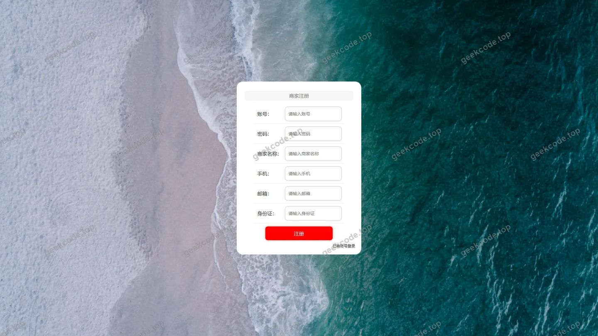</a>

<h4>前台-商品信息列表</h4>

<h4>前台-商品信息评论列表</h4>

<h4>前台个人中心</h4>

<a href="https://geekcode.top/archives/%E5%9F%BA%E4%BA%8Espringboot%E7%9A%84%E7%BD%91%E4%B8%8A%E8%B4%AD%E7%89%A9%E5%95%86%E5%9F%8E%E7%B3%BB%E7%BB%9F%E7%A0%94%E5%8F%91?utm_source=github" title="查看完整源码">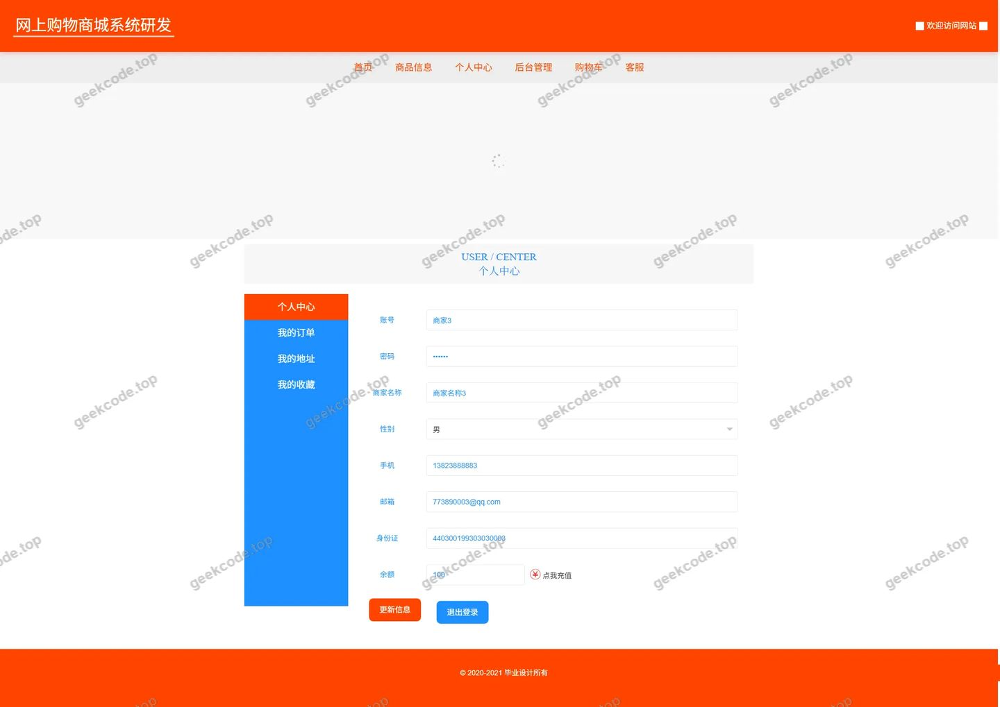</a>

<h4>前台-我的地址列表</h4>

<a href="https://geekcode.top/archives/%E5%9F%BA%E4%BA%8Espringboot%E7%9A%84%E7%BD%91%E4%B8%8A%E8%B4%AD%E7%89%A9%E5%95%86%E5%9F%8E%E7%B3%BB%E7%BB%9F%E7%A0%94%E5%8F%91?utm_source=github" title="查看完整源码">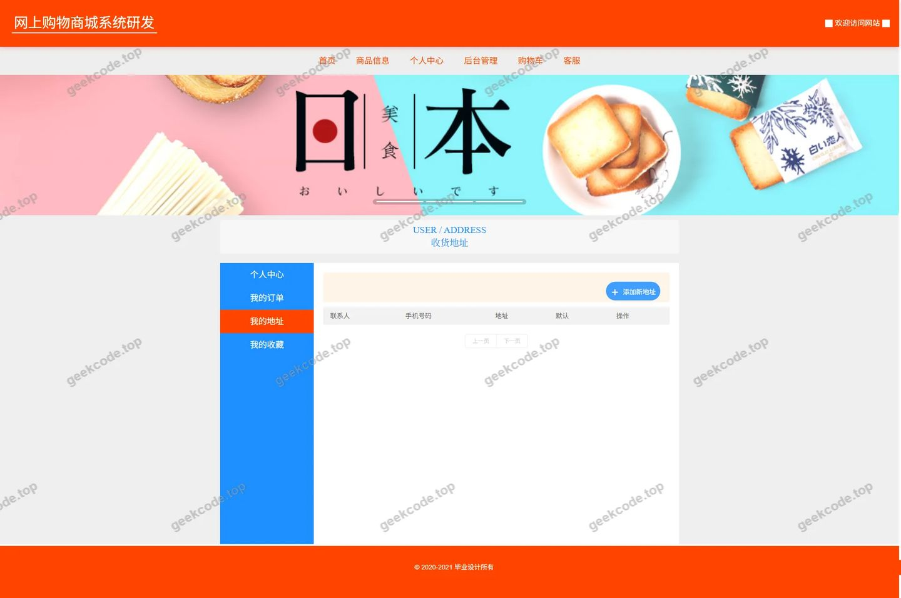</a>

<h4>前台-我的订单列表</h4>

<a href="https://geekcode.top/archives/%E5%9F%BA%E4%BA%8Espringboot%E7%9A%84%E7%BD%91%E4%B8%8A%E8%B4%AD%E7%89%A9%E5%95%86%E5%9F%8E%E7%B3%BB%E7%BB%9F%E7%A0%94%E5%8F%91?utm_source=github" title="查看完整源码">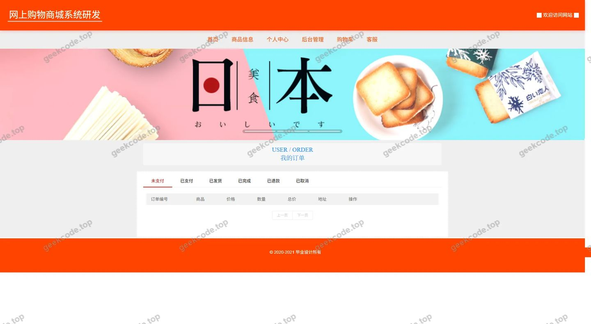</a>

<h4>前台-我的收藏列表</h4>

<a href="https://geekcode.top/archives/%E5%9F%BA%E4%BA%8Espringboot%E7%9A%84%E7%BD%91%E4%B8%8A%E8%B4%AD%E7%89%A9%E5%95%86%E5%9F%8E%E7%B3%BB%E7%BB%9F%E7%A0%94%E5%8F%91?utm_source=github" title="查看完整源码">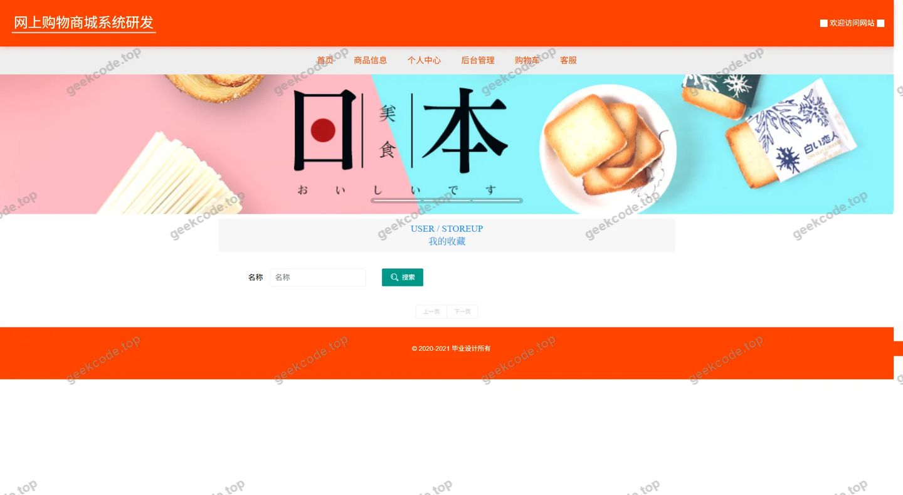</a>

<h4>前台-商品信息-详情</h4>

<a href="https://geekcode.top/archives/%E5%9F%BA%E4%BA%8Espringboot%E7%9A%84%E7%BD%91%E4%B8%8A%E8%B4%AD%E7%89%A9%E5%95%86%E5%9F%8E%E7%B3%BB%E7%BB%9F%E7%A0%94%E5%8F%91?utm_source=github" title="查看完整源码">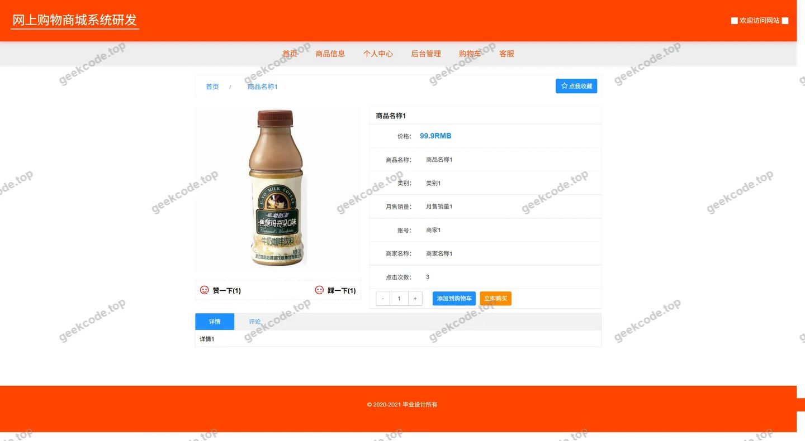</a>

<h4>前台-商品分类列表</h4>

<h4>前台-购物车列表</h4>

<h4>前台-商品信息评论-详情</h4>

<a href="https://geekcode.top/archives/%E5%9F%BA%E4%BA%8Espringboot%E7%9A%84%E7%BD%91%E4%B8%8A%E8%B4%AD%E7%89%A9%E5%95%86%E5%9F%8E%E7%B3%BB%E7%BB%9F%E7%A0%94%E5%8F%91?utm_source=github" title="查看完整源码">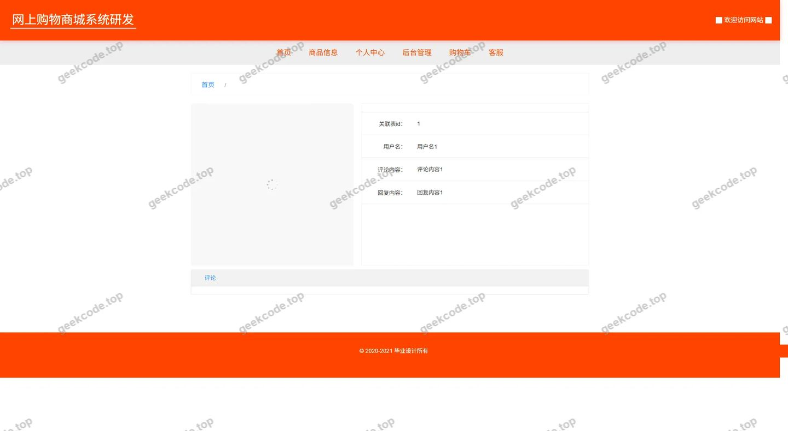</a>

<h3>后台管理端</h3>
<h4>后台-在线客服</h4>

<a href="https://geekcode.top/archives/%E5%9F%BA%E4%BA%8Espringboot%E7%9A%84%E7%BD%91%E4%B8%8A%E8%B4%AD%E7%89%A9%E5%95%86%E5%9F%8E%E7%B3%BB%E7%BB%9F%E7%A0%94%E5%8F%91?utm_source=github" title="查看完整源码">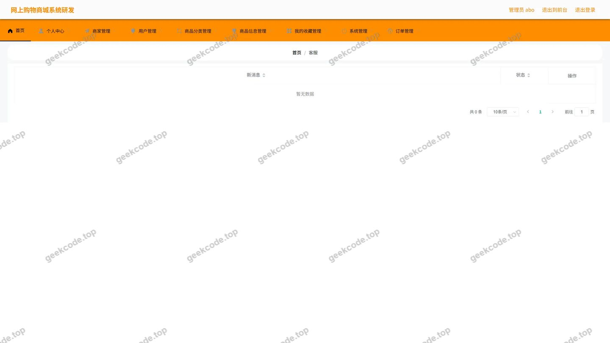</a>

<h4>后台-系统配置</h4>

<a href="https://geekcode.top/archives/%E5%9F%BA%E4%BA%8Espringboot%E7%9A%84%E7%BD%91%E4%B8%8A%E8%B4%AD%E7%89%A9%E5%95%86%E5%9F%8E%E7%B3%BB%E7%BB%9F%E7%A0%94%E5%8F%91?utm_source=github" title="查看完整源码">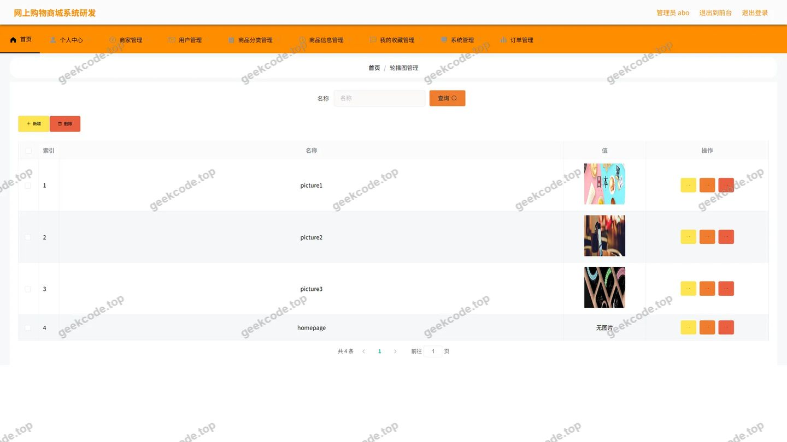</a>

<h4>后台-商品信息评论</h4>

<a href="https://geekcode.top/archives/%E5%9F%BA%E4%BA%8Espringboot%E7%9A%84%E7%BD%91%E4%B8%8A%E8%B4%AD%E7%89%A9%E5%95%86%E5%9F%8E%E7%B3%BB%E7%BB%9F%E7%A0%94%E5%8F%91?utm_source=github" title="查看完整源码">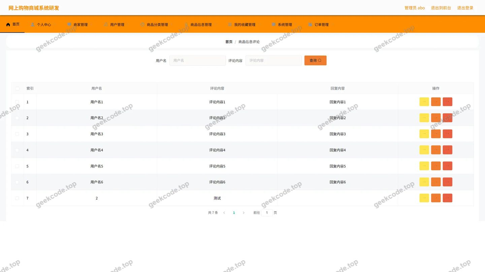</a>

<h4>后台首页</h4>

<a href="https://geekcode.top/archives/%E5%9F%BA%E4%BA%8Espringboot%E7%9A%84%E7%BD%91%E4%B8%8A%E8%B4%AD%E7%89%A9%E5%95%86%E5%9F%8E%E7%B3%BB%E7%BB%9F%E7%A0%94%E5%8F%91?utm_source=github" title="查看完整源码">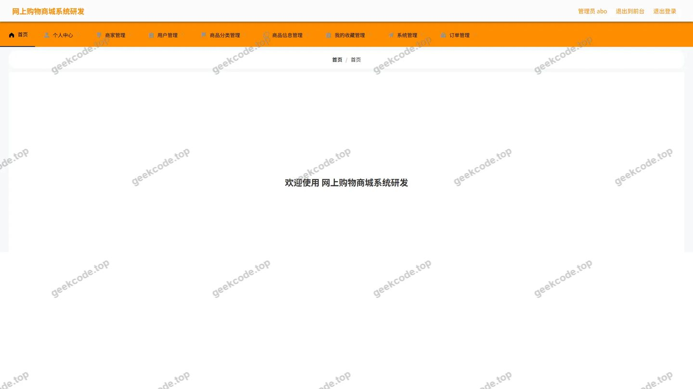</a>

<h4>后台-登录</h4>

<h4>后台-订单-状态</h4>

<a href="https://geekcode.top/archives/%E5%9F%BA%E4%BA%8Espringboot%E7%9A%84%E7%BD%91%E4%B8%8A%E8%B4%AD%E7%89%A9%E5%95%86%E5%9F%8E%E7%B3%BB%E7%BB%9F%E7%A0%94%E5%8F%91?utm_source=github" title="查看完整源码">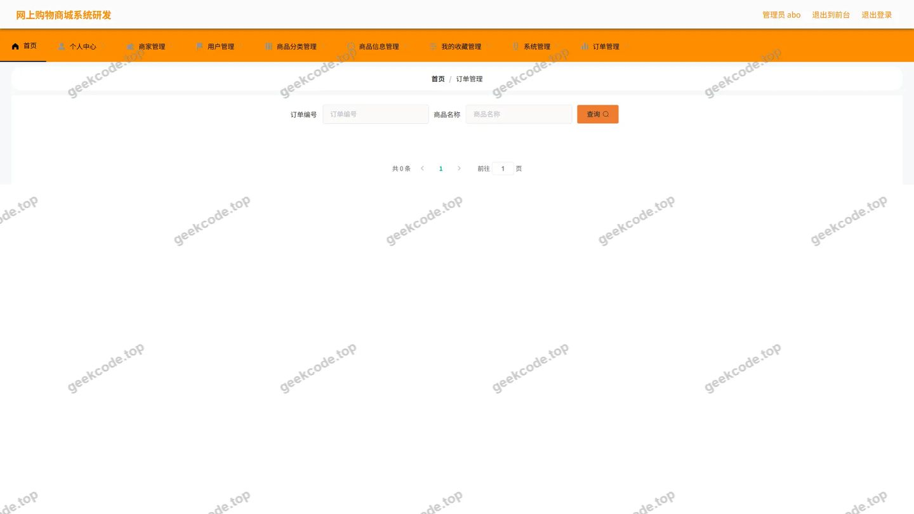</a>

<h4>后台-商家</h4>

<a href="https://geekcode.top/archives/%E5%9F%BA%E4%BA%8Espringboot%E7%9A%84%E7%BD%91%E4%B8%8A%E8%B4%AD%E7%89%A9%E5%95%86%E5%9F%8E%E7%B3%BB%E7%BB%9F%E7%A0%94%E5%8F%91?utm_source=github" title="查看完整源码">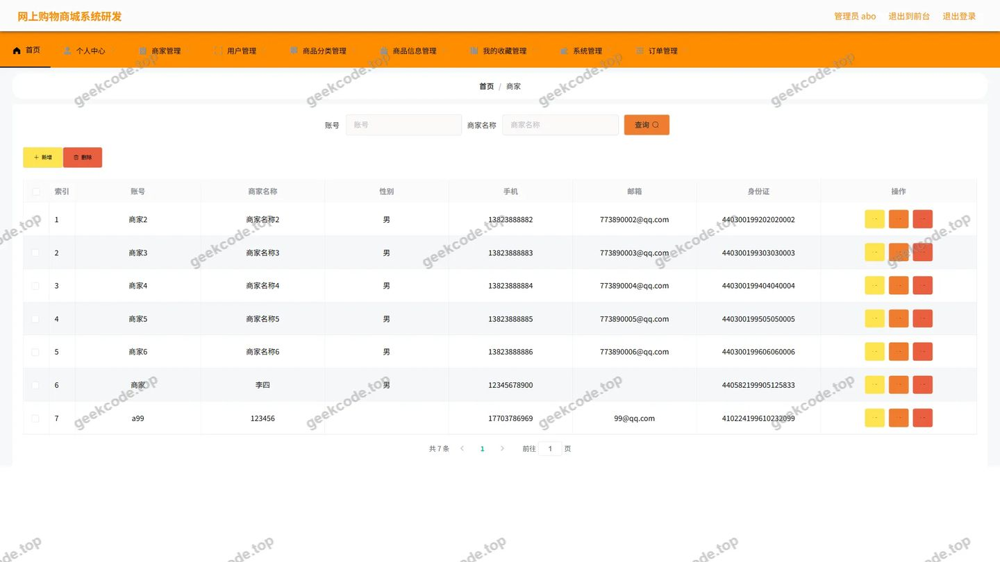</a>

<h4>后台-商品分类</h4>

<a href="https://geekcode.top/archives/%E5%9F%BA%E4%BA%8Espringboot%E7%9A%84%E7%BD%91%E4%B8%8A%E8%B4%AD%E7%89%A9%E5%95%86%E5%9F%8E%E7%B3%BB%E7%BB%9F%E7%A0%94%E5%8F%91?utm_source=github" title="查看完整源码">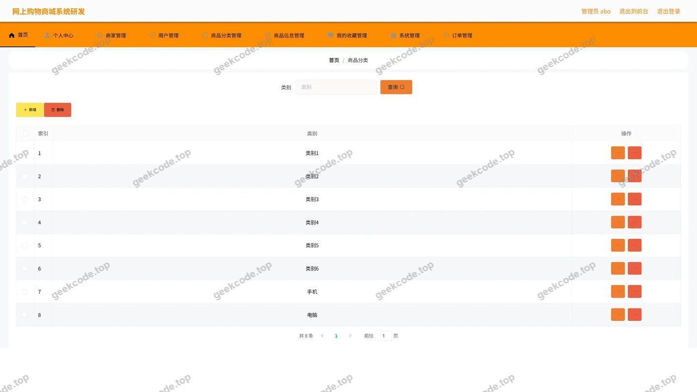</a>

<h4>后台-商品信息</h4>

<a href="https://geekcode.top/archives/%E5%9F%BA%E4%BA%8Espringboot%E7%9A%84%E7%BD%91%E4%B8%8A%E8%B4%AD%E7%89%A9%E5%95%86%E5%9F%8E%E7%B3%BB%E7%BB%9F%E7%A0%94%E5%8F%91?utm_source=github" title="查看完整源码">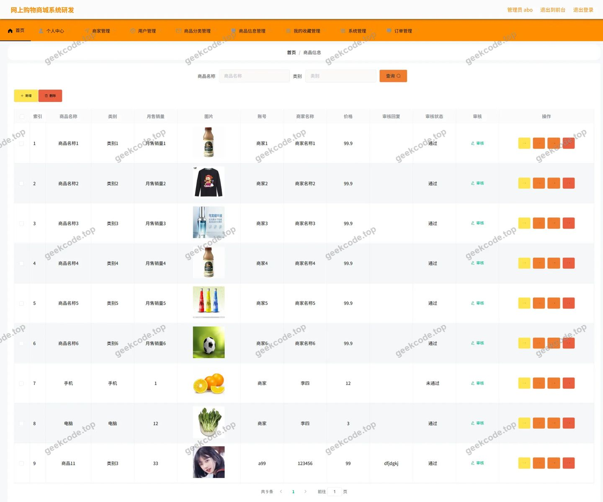</a>

<h4>后台-收藏</h4>

<a href="https://geekcode.top/archives/%E5%9F%BA%E4%BA%8Espringboot%E7%9A%84%E7%BD%91%E4%B8%8A%E8%B4%AD%E7%89%A9%E5%95%86%E5%9F%8E%E7%B3%BB%E7%BB%9F%E7%A0%94%E5%8F%91?utm_source=github" title="查看完整源码">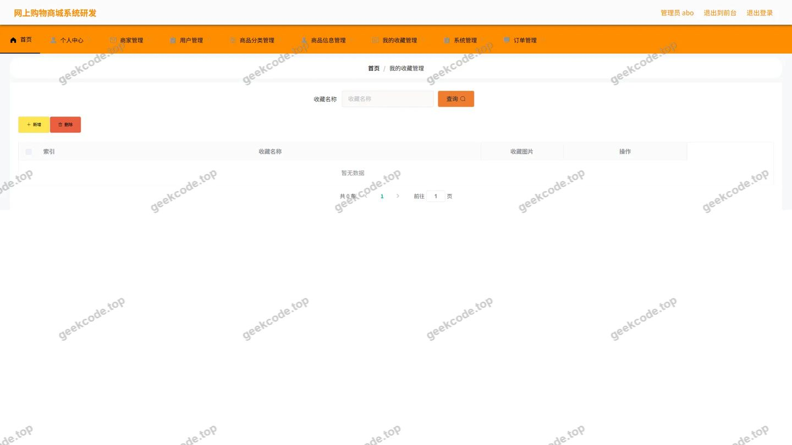</a>

---

## 获取完整源码

| 项目 | 说明 |
| --- | --- |
| 项目名 | 基于springboot的网上购物商城系统研发 |
| 运行截图 | 本文 23 张（站点带水印原图，仓库 `images/` 目录） |
| 完整源码 | [https://geekcode.top/archives/%E5%9F%BA%E4%BA%8Espringboot%E7%9A%84%E7%BD%91%E4%B8%8A%E8%B4%AD%E7%89%A9%E5%95%86%E5%9F%8E%E7%B3%BB%E7%BB%9F%E7%A0%94%E5%8F%91?utm_source=github](https://geekcode.top/archives/%E5%9F%BA%E4%BA%8Espringboot%E7%9A%84%E7%BD%91%E4%B8%8A%E8%B4%AD%E7%89%A9%E5%95%86%E5%9F%8E%E7%B3%BB%E7%BB%9F%E7%A0%94%E5%8F%91?utm_source=github) |
| 咨询微信 | **ir9372**（备注：jingpin-yuanma） |
| 更多项目 | [极客代码 geekcode.top](https://geekcode.top/?utm_source=github) |

> 需要源码、部署、改配置、跑不起来等问题，加微信 ir9372 沟通，说明项目名即可。
